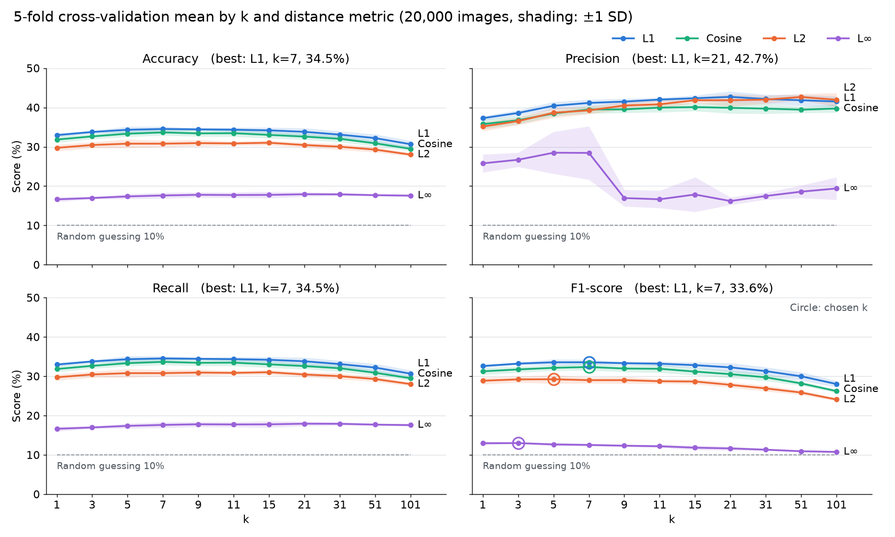
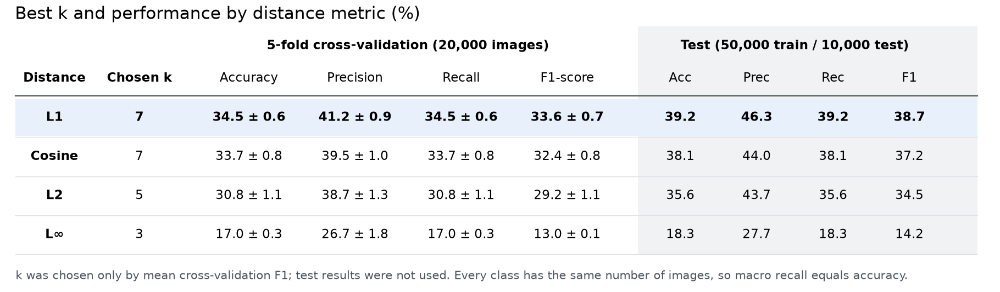
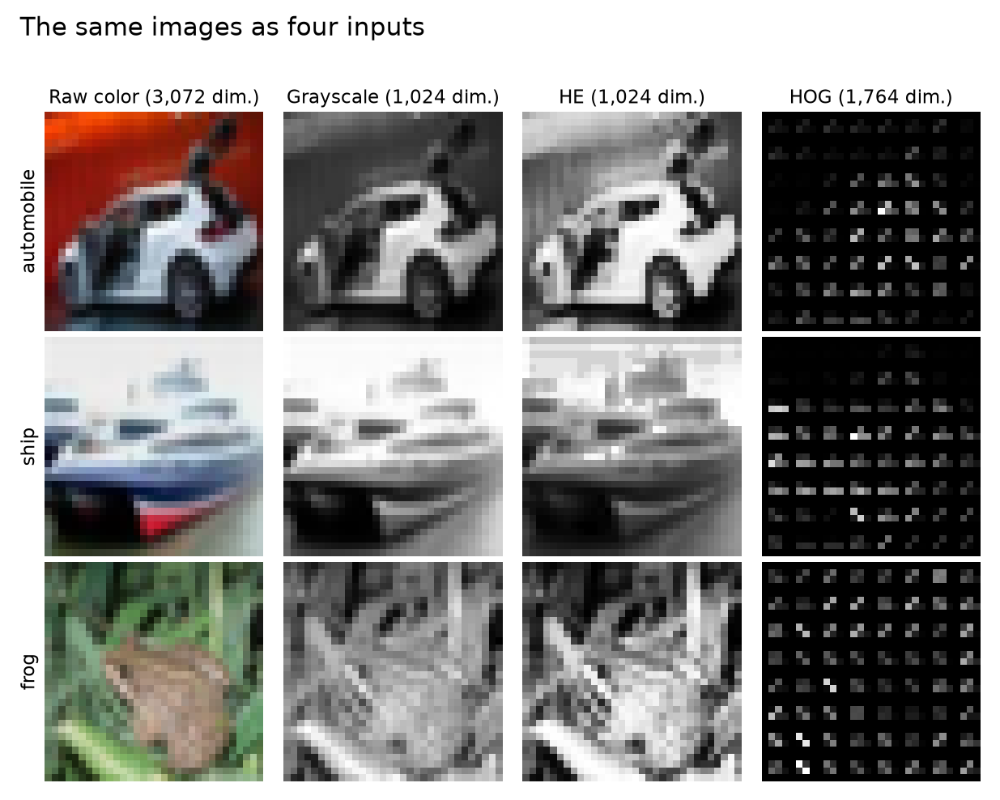
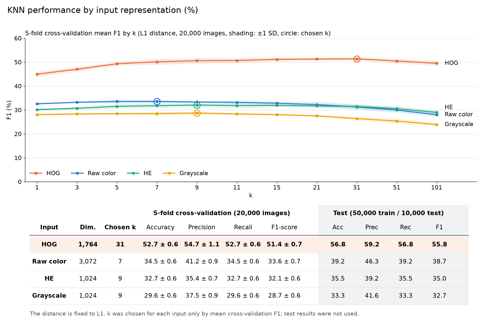

# Assignment 4: KNN on CIFAR-10

K-Nearest Neighbors implemented in NumPy and evaluated on CIFAR-10 with different values of k and different distance metrics, using 5-fold cross-validation. See [`assignment_notice.txt`](assignment_notice.txt) for the assignment.

## Method

- **Cross-validation:** 20,000 training images (2,000 per class) in five stratified folds of 16,000 train / 4,000 validation. Running all 50,000 images through every setting would take several hours on a CPU.
- **Settings:** k = 1, 3, 5, 7, 9, 11, 15, 21, 31, 51, 101 with L1, L2, L∞ and cosine distance.
- **Choosing k:** the highest mean macro F1 in cross-validation.
- **Final test:** all 50,000 training images and all 10,000 test images. Test results were not used to choose anything.

## Results





| Distance | Chosen k | Test accuracy | Test precision | Test recall | Test F1 |
|---|---:|---:|---:|---:|---:|
| **L1** | **7** | **39.2%** | **46.3%** | **39.2%** | **38.7%** |
| Cosine | 7 | 38.1% | 44.0% | 38.1% | 37.2% |
| L2 | 5 | 35.6% | 43.7% | 35.6% | 34.5% |
| L∞ | 3 | 18.3% | 27.7% | 18.3% | 14.2% |

L1 scored best. L∞ scored far lowest because it looks only at the single largest pixel difference. Macro recall equals accuracy because every class has the same number of images.

## Extra experiment: changing the input

This experiment was not required by the assignment. It keeps the KNN, the L1 distance, the images and the folds, and changes only what KNN compares: raw color pixels, grayscale pixels, histogram-equalized (HE) grayscale pixels or HOG features.





| Input | Dimensions | Chosen k | CV accuracy | Test accuracy | Test precision | Test recall | Test F1 |
|---|---:|---:|---:|---:|---:|---:|---:|
| Raw color | 3,072 | 7 | 34.5% | 39.2% | 46.3% | 39.2% | 38.7% |
| Grayscale | 1,024 | 9 | 29.6% | 33.3% | 41.6% | 33.3% | 32.7% |
| HE | 1,024 | 9 | 32.7% | 35.5% | 39.2% | 35.5% | 35.0% |
| **HOG** | **1,764** | **31** | **52.7%** | **56.8%** | **59.2%** | **56.8%** | **55.8%** |

- **HOG** raised test accuracy by 17.6 percentage points over raw pixels and beat them by 17.0-18.8 points in every cross-validation fold. It compares edge directions rather than pixel values, so it depends less on color and brightness. Automobile gained the most (F1 35.4% to 73.9%); cat stayed lowest (30.8%).
- **Grayscale** lost 5.9 test points compared with raw color, which shows that color helps pixel-based KNN.
- **HE** recovered part of that loss, scoring 2.2 test points above grayscale and higher in all five folds, but stayed below raw color.

Limitations: HOG used one fixed setting (9 orientations, 4×4-pixel cells, 2×2-cell blocks), with no tuning. It was extracted with scikit-image, while KNN and the evaluation metrics remain NumPy code. The explanations above are the likely reasons, not something this experiment tested directly.

## Running

Download `cifar-10-python.tar.gz` from the [CIFAR-10 page](https://cave.cs.toronto.edu/kriz/cifar.html) and put it in this folder. It is not in the repository because it is over GitHub's 100MB file limit.

```bash
python knn_cifar10.py
python input_representation.py
python make_figures.py
python make_repr_figures.py
```

The first two commands save neighbor results to `results/cache/`, which is not in the repository, and take about an hour or more each on a CPU. All measured results are in `results/`, and the extra experiment's are in `results/input_representation/`. `make_summary.py` optionally builds a results page, `KNN_summary.html`.

Requires NumPy. `input_representation.py` also needs scikit-image, `make_figures.py` needs Matplotlib, and `make_repr_figures.py` needs both.
