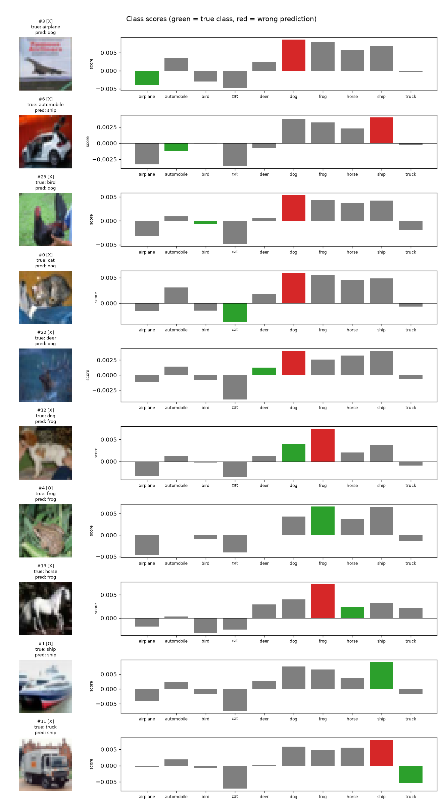
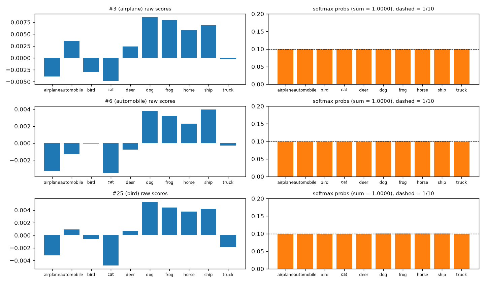
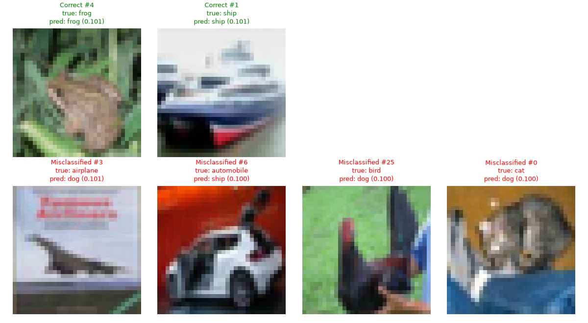
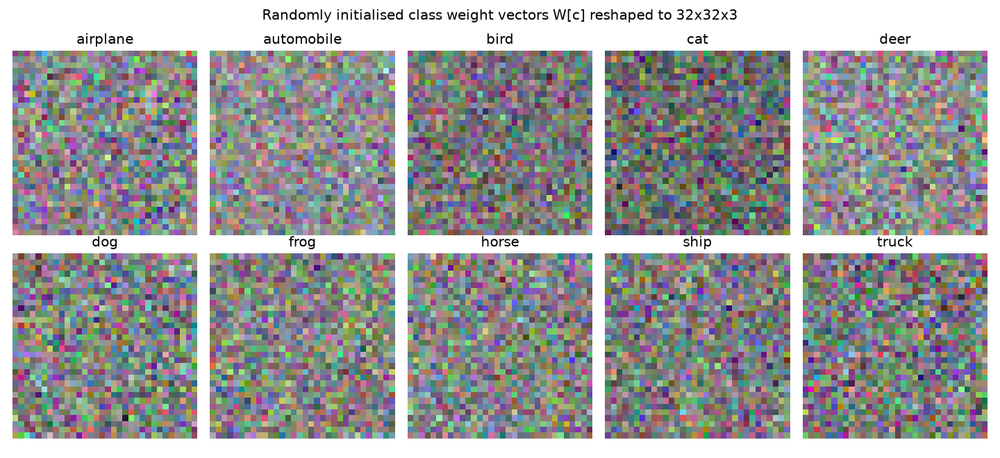
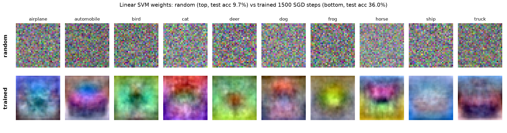

# CIFAR-10 Linear Classifier (Random Weights, No Training)

This assignment checks how a linear classifier `f(x) = Wx + b` computes class scores and predictions when its weights are random. No training is done.

- Code: [`linear_classifier.py`](linear_classifier.py) / Full numeric output: [`results/results.txt`](results/results.txt)
- Data: the first image of each class in the CIFAR-10 test batch (10 images)
- Run:
  1. `pip install numpy matplotlib`
  2. Extract the [CIFAR-10 python version](https://cave.cs.toronto.edu/kriz/cifar.html) into `data/`
  3. `python linear_classifier.py`

---

## 1. Initializing W and b

> W with small random values, b set to zero, fixed random seed

```python
rng = np.random.default_rng(42)                  # fixed seed
W = 0.0001 * rng.standard_normal((10, 3072))     # 10 classes × 3072 pixels
b = np.zeros(10)
```

The input `x` is the 32×32×3 image flattened to 3072 values and divided by 255 (range 0–1).

## 2. Scores and Prediction: `f(x) = Wx + b`

> Show all 10 class scores for each example image and use the highest-scoring class as the prediction

```python
scores = X @ W.T + b
preds = scores.argmax(axis=1)
```



| Image | True | Predicted | airplane | automobile | bird | cat | deer | dog | frog | horse | ship | truck |
|---|---|---|---|---|---|---|---|---|---|---|---|---|
| #3 | airplane | dog ✘ | -0.0039 | 0.0035 | -0.0029 | -0.0049 | 0.0024 | **0.0086** | 0.0080 | 0.0058 | 0.0069 | -0.0003 |
| #6 | automobile | ship ✘ | -0.0033 | -0.0013 | -0.0001 | -0.0036 | -0.0008 | 0.0038 | 0.0032 | 0.0023 | **0.0040** | -0.0003 |
| #25 | bird | dog ✘ | -0.0032 | 0.0009 | -0.0006 | -0.0048 | 0.0007 | **0.0053** | 0.0044 | 0.0038 | 0.0042 | -0.0019 |
| #0 | cat | dog ✘ | -0.0016 | 0.0031 | -0.0014 | -0.0036 | 0.0018 | **0.0059** | 0.0055 | 0.0046 | 0.0048 | -0.0006 |
| #22 | deer | dog ✘ | -0.0012 | 0.0014 | -0.0008 | -0.0041 | 0.0012 | **0.0040** | 0.0026 | 0.0033 | 0.0040 | -0.0007 |
| #12 | dog | frog ✘ | -0.0033 | 0.0012 | -0.0003 | -0.0036 | 0.0012 | 0.0040 | **0.0074** | 0.0020 | 0.0038 | -0.0010 |
| #4 | frog | frog ✔ | -0.0046 | -0.0000 | -0.0009 | -0.0040 | 0.0000 | 0.0043 | **0.0066** | 0.0037 | 0.0065 | -0.0014 |
| #13 | horse | frog ✘ | -0.0018 | 0.0003 | -0.0032 | -0.0025 | 0.0029 | 0.0040 | **0.0073** | 0.0025 | 0.0032 | 0.0022 |
| #1 | ship | ship ✔ | -0.0041 | 0.0023 | -0.0018 | -0.0073 | 0.0027 | 0.0076 | 0.0066 | 0.0036 | **0.0091** | -0.0016 |
| #11 | truck | ship ✘ | -0.0003 | 0.0019 | -0.0007 | -0.0070 | 0.0002 | 0.0058 | 0.0047 | 0.0055 | **0.0079** | -0.0053 |

**Explanation:** The weights are small, so every score is within ±0.01. The bar shapes are almost the same for every image, so the predictions pile up on dog, frog and ship.

## 3. Multiclass SVM Hinge Loss

> Implement the SVM hinge loss and report the average loss over the example images

$$L_i = \sum_{j \ne y_i} \max(0,\ s_j - s_{y_i} + 1)$$

```python
margins = np.maximum(0, scores - scores[np.arange(N), y][:, None] + 1)
margins[np.arange(N), y] = 0
loss = margins.sum(axis=1).mean()
```

| Image | #3 | #6 | #25 | #0 | #22 | #12 | #4 | #13 | #1 | #11 | **Average** |
|---|---|---|---|---|---|---|---|---|---|---|---|
| Loss | 9.0624 | 9.0169 | 9.0148 | 9.0545 | 8.9975 | 8.9712 | 8.9438 | 8.9905 | 8.9264 | 9.0660 | **9.0044** |

**Explanation:** When all scores are close to 0, each of the 9 wrong classes adds about 1, so the loss is about **C − 1 = 9**. The result matches this expected value.

## 4. Softmax

> Implement Softmax, compare the scores with the probabilities, and check that each image's probabilities sum to 1

```python
exp = np.exp(scores - scores.max(axis=1, keepdims=True))
probs = exp / exp.sum(axis=1, keepdims=True)
```



| Image | airplane | automobile | bird | cat | deer | dog | frog | horse | ship | truck | **Sum** |
|---|---|---|---|---|---|---|---|---|---|---|---|
| #3 | 0.0994 | 0.1001 | 0.0995 | 0.0993 | 0.1000 | **0.1006** | 0.1006 | 0.1003 | 0.1005 | 0.0997 | **1.0** |
| #6 | 0.0996 | 0.0998 | 0.1000 | 0.0996 | 0.0999 | 0.1003 | 0.1003 | 0.1002 | **0.1004** | 0.0999 | **1.0** |
| #25 | 0.0996 | 0.1000 | 0.0999 | 0.0994 | 0.1000 | **0.1004** | 0.1004 | 0.1003 | 0.1003 | 0.0997 | **1.0** |
| #0 | 0.0997 | 0.1001 | 0.0997 | 0.0995 | 0.1000 | **0.1004** | 0.1004 | 0.1003 | 0.1003 | 0.0998 | **1.0** |
| #22 | 0.0998 | 0.1000 | 0.0998 | 0.0995 | 0.1000 | **0.1003** | 0.1002 | 0.1002 | 0.1003 | 0.0998 | **1.0** |
| #12 | 0.0996 | 0.1000 | 0.0999 | 0.0995 | 0.1000 | 0.1003 | **0.1006** | 0.1001 | 0.1003 | 0.0998 | **1.0** |
| #4 | 0.0994 | 0.0999 | 0.0998 | 0.0995 | 0.0999 | 0.1003 | **0.1006** | 0.1003 | 0.1005 | 0.0998 | **1.0** |
| #13 | 0.0997 | 0.0999 | 0.0995 | 0.0996 | 0.1001 | 0.1003 | **0.1006** | 0.1001 | 0.1002 | 0.1001 | **1.0** |
| #1 | 0.0994 | 0.1001 | 0.0996 | 0.0991 | 0.1001 | 0.1006 | 0.1005 | 0.1002 | **0.1007** | 0.0997 | **1.0** |
| #11 | 0.0998 | 0.1001 | 0.0998 | 0.0992 | 0.0999 | 0.1005 | 0.1003 | 0.1004 | **0.1007** | 0.0993 | **1.0** |

**Explanation:**
- **Sum of probabilities:** exactly 1 for all 10 images (`np.allclose(probs.sum(1), 1) = True`).
- **Scores vs. probabilities:** Softmax keeps the order, so the prediction does not change. The score differences are tiny, though, so every probability is **about 0.1 (= 1/10)**: the model is not confident about any class.
- The original scores for each image are in the table in section 2.

## 5. Correct and Misclassified Examples

> Show correctly and incorrectly classified examples and briefly explain them



- **Correct (2 images):** #4 frog → frog, #1 ship → ship
- **Wrong (8 images):** airplane, bird, cat, deer → dog; automobile, truck → ship; dog, horse → frog

**Explanation:** The 2 correct ones are luck.
- All pixel values are positive, so a class whose weight row has a large sum gets a high score on any image.
- With this seed, dog (0.0120), frog (0.0121) and ship (0.0122) have the largest sums, so only the images whose true class is frog or ship were classified correctly.
- Even for the correct ones the probability is about 0.101, no better than guessing (0.1).

## 6. Weight Visualization (32 × 32 × 3)

> Visualize each class's weights as an image and explain why no learned class features appear

```python
w = W[c].reshape(3, 32, 32).transpose(1, 2, 0)
plt.imshow((w - w.min()) / (w.max() - w.min()))
```



**Explanation:** All 10 classes look like noise.
- Every value is drawn independently, so there is no relation between neighbouring pixels or between color channels. No shapes or color patterns can form.
- Class templates (e.g. a blue background for ship, green for frog) only appear through **training** on data. No training was done here, so W contains no information from the data.

---

## Conclusion

The pipeline (scores → prediction → loss → probabilities) works correctly. With random weights, however:
- The SVM loss is about 9, the expected value before training.
- The probabilities are uniform, about 0.1 each.
- The predictions are decided by chance.

W has to be trained to get meaningful classifications.

---

## Extra: What Would Trained Weights Look Like?

> Not required by the assignment. The same linear classifier was trained briefly to compare with the random weights in section 6.

- Script: [`train_compare.py`](train_compare.py)
- Setup: 50,000 training images (pixels minus the mean image), multiclass SVM loss + L2 regularization, minibatch SGD (batch 200, lr 1e-7, reg 2.5e4, 1500 iterations), seed 42



| | Random W (this assignment) | Trained W |
|---|---|---|
| Test accuracy (10,000 images) | 9.7% (chance level) | **36.0%** |
| Weight images | Noise | **Blurry class templates** |

**What the trained weights show:** Each class's weights look like an "average image" of that class.

| Class | What appears | Why |
|---|---|---|
| airplane, ship | Blue background | Sky and sea photos |
| automobile | Red body in the middle, window on top | Many red cars seen from the front |
| bird, deer, frog | Green and brown background | Grass and forest |
| horse | A horse with a head on **both sides** | Left-facing and right-facing horses are mixed |
| truck | Large dark body at the bottom | Trucks fill the lower part of the image |

**Why this happens:**
- The score `W[c] · x` is high when the image looks like the weight image.
- Training therefore pushes each class's weights toward images of that class and away from other classes, which creates the templates.
- Random weights contain none of this information, which is why section 6 shows only noise.

**Limits of a linear classifier:**
- It has only one template per class, so different poses get blended together (the two-headed horse).
- It relies heavily on color and background, so accuracy stays around 36–40%.
